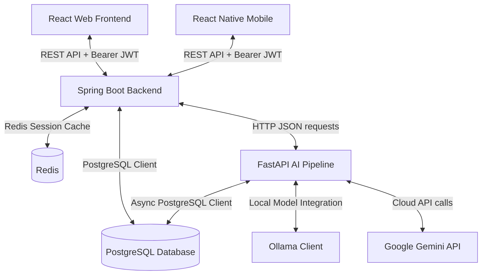

# Project Knowledge Transfer (KT) Document: Auto Apply Pro

Welcome to the **Auto Apply Pro** development team! This document serves as a comprehensive onboarding guide and technical knowledge transfer reference for new engineers. It outlines the codebase layout, core architectural patterns, technology stack, and step-by-step setup guides to help you get up to speed quickly.

---

## 1. Project Overview

**Auto Apply Pro** is an AI-powered career coach and job search automation platform designed to simplify the job hunting process. 

### The Business Problem
Job seekers experience significant "application fatigue" due to the slow, repetitive, and error-prone process of manually searching for jobs, tailoring resumes, customizing outreach emails, and tracking statuses across multiple platforms.

### The Solution
Auto Apply Pro acts as an intelligent automation agent. It streamlines the repetitive phases of job hunting (outreach drafting, email scheduling, and tracking) by parsing job descriptions from screenshots or URLs, generating personalized cold outreach emails using LLMs, and sending them securely via the candidate’s connected email provider. This allows job seekers to focus on high-value activities like interview preparation and technical upskilling.

---

## 2. Technology Stack

The project is structured as a monorepo containing four main directories: `backend`, `frontend`, `pipeline`, and `mobile`.

### Backend (Core API Server)
* **Framework:** Spring Boot `4.0.6` (Core MVC framework)
* **Language:** Java `25` (LTS)
* **Database & ORM:** PostgreSQL, Spring Data JPA / Hibernate (Schema automatically managed via `spring.jpa.hibernate.ddl-auto=update`)
* **Security & Auth:** Spring Security (JWT-based token security), Google OAuth2 Client (`spring-boot-starter-oauth2-client`)
* **Email Services:** Spring Boot Starter Mail, Google API Client (`2.2.0`) & Google API Services Gmail for OAuth-secured outreach
* **Payment Gateway:** Razorpay Java SDK (`1.4.3`)
* **Caching & Sessions:** Redis (Spring Data Redis)
* **API Documentation:** OpenAPI / Swagger (`springdoc-openapi-starter-webmvc-ui` version `2.8.5`)
* **Templating:** Spring Boot Starter Mustache (`spring-boot-starter-mustache`) for email formatting

### Frontend (SaaS Web Dashboard)
* **Core Library:** React `19.2.6`
* **Development Environment:** Vite `8.0.12` with TypeScript `~6.0.2`
* **Styling:** Tailwind CSS `3.4.19`, PostCSS, Autoprefixer
* **Routing:** React Router DOM `7.17.0`
* **File Uploads:** React Dropzone `15.0.0`
* **SEO Metadata:** React Helmet Async `3.0.0`

### AI Outreach Pipeline (AI / OCR Microservice)
* **Framework:** FastAPI `0.100.0` (asynchronous python service)
* **Web Server:** Uvicorn `0.22.0`
* **Package Management:** Poetry
* **Database & Migration:** Asyncpg `0.28` (asynchronous Postgres client), SQLAlchemy `2.0`, Alembic `1.12`
* **Local Models (via Ollama):** `deepseek-ocr` (or `deepseek-vision:7b` for screenshot reading) and `ollama3.1:8b` (for general LLM text tasks)
* **Production LLM API:** Google Generative AI (`google-generativeai` version `0.8.3`) for Gemini Pro and Gemini Flash integration
* **Document Parsing:** PyPDF `3.0`, python-docx `0.8`, Pillow `9.0` (image editing/OCR)
* **Logging & Telemetry:** Loguru `0.7`, Psutil `5.9`

### Mobile Client (Cross-Platform Mobile App)
* **Framework:** React Native (via Expo `~56.0.12`)
* **Router:** Expo Router `~56.2.11` (file-based navigation)
* **Styling:** NativeWind `4.2.6` (Tailwind CSS for React Native)
* **State & Data Fetching:** TanStack React Query `^5.101.2`, Axios `1.18.1`
* **Secure Storage:** Expo Secure Store `~56.0.4`
* **Biometric Auth:** Expo Local Authentication `~56.0.4` (FaceID / Fingerprint)
* **Media / Files:** Expo Document Picker `~56.0.4`, Expo Web Browser `~56.0.5`

---

## 3. Architecture & Design Patterns

Auto Apply Pro utilizes a monorepo architecture with decoupled backend APIs and an AI worker service.



### Key Architectural Approaches
1. **Decoupled API Design:** The Spring Boot backend exposes endpoints for CRUD operations, user metrics, and application state. All computation-heavy AI processing (OCR, resume parsing, and email compilation) is delegated to the FastAPI Python service to avoid blocking web threads.
2. **Local vs. Cloud LLM Routing:** The system defaults to local execution (`deepseek-ocr` and `ollama3.1:8b` via Ollama) during development to reduce cost. Production builds route requests to Google’s Gemini API (`gemini-1.5-pro` for high-intelligence drafting and `gemini-1.5-flash` for low-cost parsing).

### Implemented Design Patterns
* **Repository Pattern:** Separates database operations from business logic using Spring Data JPA Repositories in the backend and SQLAlchemy asynchronous sessions in the pipeline.
* **Service Layer Pattern:** Centralizes business capabilities (e.g., `UserService`, `BillingService`, `LearningService`) into transaction-boundary service classes.
* **Data Transfer Object (DTO) Pattern:** Ensures strict separation between internal database models and external JSON request/response formats.
* **Decorator Pattern:** Used in the outreach engine to intercept and enrich email drafts with personalized candidate tokens.
* **Scheduled Orchestrator (Cron Jobs):** 
  - `OutreachOrchestrator` runs every minute to process pending outreach emails, check user timezone active hours, and enforce anti-spam limits.
  - `UserDeletionScheduler` runs hourly to permanently anonymize cancelled accounts.
* **Audit-Compliant Soft Deletion:** In compliance with financial audits, deleted user records are anonymized rather than hard-deleted. Personal information (resumes, credentials, logs) is purged, and the user status is set to `DELETED`, leaving the primary keys intact for transaction reference.

---

## 4. Folder Structure

Below is the directory map of the Auto Apply Pro repository:

```
├── backend/
│   ├── src/main/java/com/backend/autoapplypro/
│   │   ├── config/                     # Configuration classes (Security, Redis Cache, Seeders, JWT)
│   │   ├── HrList/                     # Database of verified recruiters and company contacts
│   │   ├── modules/                    # Main business domains structured as submodules
│   │   │   ├── billing/                # Subscription plans, payment transactions, Razorpay webhook controllers
│   │   │   ├── feedback/               # Help desk, system feedback collection
│   │   │   ├── jobs/                   # Job application models, screenshot uploads, application tracker
│   │   │   ├── learning/               # Roadmaps, topics, completing resources, quiz grading
│   │   │   ├── outreach/               # Gmail OAuth connections, template engine, outreach scheduler
│   │   │   ├── referrals/              # Professional referral request tracking
│   │   │   └── users/                  # User accounts, JWT auth, user profile, soft deletion scheduling
│   │   └── BackendApplication.java     # Main entry point
│   ├── src/main/resources/
│   │   ├── application.properties      # Core configuration properties (database URL, client secrets)
│   │   └── application-*.properties    # Environment-specific configuration profiles (dev-local, dev-ngrok)
│   └── pom.xml                         # Maven build file
│
├── frontend/
│   ├── src/
│   │   ├── components/                 # Global UI controls (Header, sidebar drawer, interactive onboarding walkthrough)
│   │   ├── config/                     # Core API base URL resolvers
│   │   ├── features/                   # Feature subdirectories containing components, state hooks, and API services
│   │   │   ├── billing/                # Stripe/Razorpay UI pricing tables
│   │   │   ├── jobs/                   # Drag-and-drop screenshot uploader, crop/rotate modal
│   │   │   ├── learning/               # Learning progress, roadmap views, practice quiz pages
│   │   │   └── outreach/               # Template management, draft review cards, email queue tracking
│   │   ├── pages/                      # Root page views (Landing page, Login, Job Tracker dashboard)
│   │   └── routes/                     # React Router configurations (AppRoutes.tsx)
│   └── package.json                    # Node.js dependencies
│
├── pipeline/
│   ├── src/
│   │   ├── stage1_jd_extraction/       # OCR screenshot processing using Ollama / deepseek-ocr
│   │   ├── stage2_resume_parsing/      # File loading (PyPDF/docx) and candidate profile mapping
│   │   ├── stage3_email_gen/           # Generates draft templates, personalized hooks, and recipient routing
│   │   ├── telemetry.py                # Telemetry tracking for API costs, tokens, and model latency
│   │   ├── llm_client.py               # Handles client requests to Google Gemini and local Ollama
│   │   └── server.py                   # FastAPI service endpoints
│   ├── pyproject.toml                  # Poetry environment configuration
│   └── alembic.ini                     # Database migration configuration
│
├── mobile/
│   ├── app/                            # Expo Router file-based views
│   │   ├── (auth)/                     # Auth routes (Login, biometrics verification)
│   │   ├── (tabs)/                     # Main bottom tabs navigation (Dashboard index, queue tracking, profile)
│   │   └── _layout.tsx                 # App entry layout (contains AuthProvider and biometric unlock logic)
│   ├── context/                        # App contexts (AuthContext handling secure biometrics sessions)
│   ├── services/                       # Local services (Axios client, biometrics wrapper, expo-secure-store config)
│   └── package.json                    # React Native Expo dependencies
│
└── docker-compose.yml                  # Production/Staging multi-container configuration
```

---

## 5. Core Features

### 🖼️ Screenshot Parsing & Cropping
* Users can drag-and-drop or upload screenshots of job postings.
* Integrates a custom frontend crop/rotate image editor modal.
* The backend sends the image to the FastAPI pipeline, which runs `deepseek-ocr` to extract details (title, company, salary, location, and HR emails).

### 📝 AI Email Drafting & Templating
* Supports writing email templates with Mustache placeholders (e.g., `{{jobRole}}`, `{{companyName}}`).
* Combines candidate profiles (skills, experiences) with extracted job descriptions using Gemini/Ollama to draft personalized outreach emails.
* Personalization hooks are dynamically injected to improve recruiter response rates.

### 📅 Dynamic Email Scheduler (Gmail OAuth integration)
* Connects directly to the user's Gmail using Google OAuth2 (requesting `gmail.send` scopes).
* Implements a background scheduler that calculates the optimal send times based on the candidate's custom timezone (excluding weekends and non-business hours).
* Spacing guardrails and daily quotas protect the user's domain reputation.

### 📚 Learning Space & Practice Quizzes
* Career curriculum roadmaps (e.g., "Frontend Developer", "AI Engineer") divided into sequential learning milestones.
* completion progress trackers for learning tutorials (videos, documentations).
* Practice quizzes with instant AI grading and conceptual explanations.
* Daily tip popup displays mock interview advice on the candidate dashboard.

### 📱 Biometrics & Mobile Dashboard
* Synchronized mobile tracking app built with Expo and NativeWind.
* Persists user tokens in native Secure Store.
* Integrates biometrics (Face ID/Touch ID) unlock routines.
* Real-time mobile dashboard mapping candidate skills and parsing status logs.

### 💳 Razorpay Payments & Subscriptions
* Subscriptions mapping active pricing plans (e.g., Pro, Enterprise).
* Verifies Razorpay checkout orders and webhook signature verification (`X-Razorpay-Signature`) to handle active subscriptions.

---

## 6. API Endpoints

### 🔐 Authentication (`/api/v1/auth`)
| HTTP Method | Route | Purpose | Request Body | Response JSON |
| :--- | :--- | :--- | :--- | :--- |
| **POST** | `/register` | Register a new user | `RegisterRequest` (email, password, name, role, mobile) | `AuthResponse` containing token, user info |
| **POST** | `/login` | Log in and receive JWT | `LoginRequest` (email, password) | `AuthResponse` containing token, user info |
| **POST** | `/forgot-password` | Initiate password reset | `ForgotPasswordRequest` (email) | Message confirming reset link sent |
| **POST** | `/reset-password` | Set new password | `ResetPasswordRequest` (token, newPassword) | Confirmation message |

### 👤 Candidate Profiles (`/api/v1/profiles`)
| HTTP Method | Route | Purpose | Request Body | Response JSON |
| :--- | :--- | :--- | :--- | :--- |
| **GET** | `/candidate/{userId}` | Fetch candidate profile info | None | `CandidateProfileDto` (skills, experiences) |
| **PUT** | `/candidate/{userId}` | Update candidate profile info | `CandidateProfileDto` | Updated candidate profile details |
| **POST** | `/candidate/{userId}/resume` | Upload PDF/Docx resume | `MultipartFile` (file) | Confirmation message |
| **POST** | `/candidate/{userId}/resume/sync` | Sync profile details from resume | None | Status message confirming sync completion |
| **GET** | `/candidate/{userId}/resume` | Download raw uploaded resume file | None | Byte Stream (attachment; filename) |
| **POST** | `/delete-request` | Submit user account deletion request | None (JWT context) | Deletion pending message |

### 💼 Job Tracker (`/api/job-applications`)
| HTTP Method | Route | Purpose | Request Body | Response JSON |
| :--- | :--- | :--- | :--- | :--- |
| **GET** | `/user/{userId}` | List tracked job applications | None | List of `JobApplication` objects |
| **POST** | `/user/{userId}` | Create new job tracking entry | `JobApplication` details | Created application object |
| **PUT** | `/{id}/status` | Update tracked application status | Status parameter (e.g., "Interviewing") | Updated job application object |
| **GET** | `/user/{userId}/stats` | Fetch application metrics | None | `JobApplicationStatsDto` (counts by status) |

### ✉️ Outreach OAuth Connection (`/api/v1/outreach`)
| HTTP Method | Route | Purpose | Query Parameters | Response / Behavior |
| :--- | :--- | :--- | :--- | :--- |
| **GET** | `/connect/google` | Fetch Google authorization consent URL | `userId` | Plaintext OAuth Auth URL |
| **GET** | `/oauth2/callback` | Callback endpoint for Google OAuth code | `code`, `state` (userId) | Redirects back to Frontend Profile page |
| **GET** | `/status` | Check if Gmail connected | `userId` | JSON: `{"connected": true, "connectedEmail": "..."}` |
| **POST** | `/disconnect` | Disconnect Gmail | `userId` | Confirmation message |

### 📧 Outreach Drafts (`/api/drafts`)
| HTTP Method | Route | Purpose | Request Body / Query Params | Response JSON |
| :--- | :--- | :--- | :--- | :--- |
| **POST** | `/generate` | Generate email from resume & JD | `EmailGenerationRequestDto`, `regenerate=true/false` | `EmailGenerationResponseDto` (subject, body) |
| **POST** | `/` | Save/Queue draft email | `OutreachDraftDto` | Saved DTO with ID, scheduled send date |
| **PUT** | `/{id}` | Approve and schedule draft | `OutreachDraftDto` | Updated DTO with status PENDING |
| **GET** | `/user/{userId}` | List user’s email queue/logs | None | List of email status logs (PENDING, SENT, FAILED) |

### 📚 Learning Space (`/api/v1/learning`)
| HTTP Method | Route | Purpose | Headers | Response JSON |
| :--- | :--- | :--- | :--- | :--- |
| **GET** | `/topics` | Get complete topic hierarchy | None | Hierarchical list of topics and subtopics |
| **GET** | `/topics/{topicId}/questions` | Get practice quizzes for topic | Bearer Token | Quiz questions (multiple choice options) |
| **POST** | `/questions/{questionId}/submit` | Grade practice answer | Bearer Token | `SubmitResponseDto` (correct option, AI explanation) |
| **GET** | `/roadmaps` | Get curriculum learning roadmaps | Bearer Token | List of progress-tracked roadmaps |

### 💳 Billing & Plans (`/api/v1/billing`)
| HTTP Method | Route | Purpose | Headers / Request Body | Response JSON |
| :--- | :--- | :--- | :--- | :--- |
| **GET** | `/plans` | Get pricing plan information | None | List of active plan schemas (prices, features) |
| **POST** | `/subscribe` | Create payment subscription order | Bearer Token, `CreateSubscriptionRequest` | Razorpay Order ID & checkout config parameters |
| **POST** | `/verify` | Validate payment signature | Bearer Token, `SubscriptionVerifyRequest` | Verification status message |
| **POST** | `/webhook` | Handle async Razorpay status updates | `X-Razorpay-Signature` (header) | Webhook completion response (`OK`) |

---

## 7. Python AI Pipeline API (Port `8000`)

The FastAPI service operates as an independent backend node. The Spring Boot backend makes HTTP requests to it.

* **`POST /extract-job-details`**
  * **Payload:** Image file multipart (`file`).
  * **Behavior:** Processes screenshot with `deepseek-ocr`, parses JSON tokens, formats salary ranges and returns `JobDetailsDto` containing extracted titles, recruiter emails, and skills.
* **`POST /parse-resume`**
  * **Payload:** PDF/Docx file multipart (`file`).
  * **Behavior:** Reads resume contents via local loaders, maps structure (skills, job experience, summary) and returns Candidate profile JSON.
* **`POST /generate-email`**
  * **Payload:** JSON request body containing `job_details` and `candidate` profile.
  * **Behavior:** Integrates with LLM client to compile outreach emails with customized subjects and body strings.
* **`POST /parse-job-url`**
  * **Payload:** JSON body `{"url": "..."}`.
  * **Behavior:** Triggers SSRF protection check. If safe, downloads HTML content, strips tags, cuts content to 8000 tokens, parses JD and returns structured fields.
* **`GET /llm-stats`**
  * **Behavior:** Summarizes local `.logs/llm_usage.jsonl` performance metrics (total tokens, processing cost, latency).

---

## 8. Frontend Flow

### Navigation Hierarchy
* **Public Route Group:** Landing Page `/` $\rightarrow$ Auth Screen `/login` $\rightarrow$ Pass Reset `/forgot-password`.
* **Authenticated Route Group:** (Protected via `Layout.tsx` which verifies JWT token presence in `localStorage`).
  * **Candidate Dashboard (`/candidate-dashboard`):** Active metrics, daily interview tips.
  * **Application Tracker (`/jobs/applications`):** Columns showing status (Pending, Applied, Interviewing, Offered).
  * **Screenshot Parser (`/jobs/parse`):** Crop UI panel where screenshots are processed.
  * **Outreach Queue (`/outreach/drafts/review`):** Panel where candidate reviews email templates and clicks "Approve". Approved emails are added to the background SMTP dispatch queue.
  * **Learning Hub (`/learning`):** Displays roadmaps and subtopics. Selecting a topic opens practice questions.

### State & Auth Management
1. **User Sessions:** Handled directly via `localStorage.setItem("user", JSON.stringify(userData))`. The object stores the user's database ID, name, email, role, and bearer JWT token.
2. **API Communication:** Standard HTTP fetches. All protected API requests fetch the token and inject it as a bearer header:
   ```typescript
   Authorization: Bearer <token>
   ```
3. **Backend Proxy:** The Vite environment is configured to route all frontend `/api` requests directly to `VITE_API_PROXY_TARGET` (configured via env variables, defaults to `http://localhost:8060`).

---

## 9. Development Environment Setup

Follow these steps to get all services running locally.

### Step 1: Database Setup
1. Start your local PostgreSQL server.
2. Create a new database named `autoapplypro`:
   ```sql
   CREATE DATABASE autoapplypro;
   ```
3. Default database connection details:
   - **URL:** `jdbc:postgresql://localhost:5432/autoapplypro`
   - **Username:** `amrit`
   - **Password:** `amrit123`
   *(Edit database credentials in `backend/src/main/resources/application.properties` if yours differ).*

### Step 2: Set Up & Run Ollama (Local AI models)
1. Download and install [Ollama](https://ollama.com/).
2. Pull the required models:
   ```bash
   ollama pull deepseek-ocr
   ollama pull llama3.1:8b
   ```
3. Verify Ollama is running at `http://localhost:11434`.

### Step 3: Run the FastAPI AI Pipeline
1. Navigate to the pipeline directory:
   ```bash
   cd pipeline
   ```
2. Copy the environment variables:
   ```bash
   cp .env.example .env
   ```
3. Install dependencies:
   ```bash
   poetry install
   ```
4. Run Alembic migrations:
   ```bash
   poetry run alembic upgrade head
   ```
5. Start the server on port `8000`:
   ```bash
   poetry run uvicorn src.server:app --host 0.0.0.0 --port 8000 --reload
   ```

### Step 4: Run the Spring Boot Backend
1. Open a new terminal and navigate to the backend directory:
   ```bash
   cd backend
   ```
2. Start the backend on port `8080` using the local development profile (`dev-local` profile ensures callback routes redirect to the correct port):
   ```bash
   ./mvnw spring-boot:run -Dspring-boot.run.profiles=dev-local
   ```
3. Validate that Swagger documentation is loaded at `http://localhost:8080/swagger-ui.html`.

### Step 5: Start the React Web Frontend
1. Navigate to the frontend directory:
   ```bash
   cd frontend
   ```
2. Install dependencies:
   ```bash
   npm install
   ```
3. Start the development server pointing proxy target to backend (`port 8080`):
   ```bash
   VITE_API_PROXY_TARGET=http://localhost:8080 npm run dev
   ```
4. Access the web app in your browser at `http://localhost:5173`.

### Step 6: Start the Mobile Client
1. Navigate to the mobile directory:
   ```bash
   cd mobile
   ```
2. Install dependencies:
   ```bash
   npm install
   ```
3. Start the Expo development server:
   ```bash
   npm run start
   ```
4. Press `i` to launch in iOS Simulator, `a` for Android Emulator, or scan the QR code using the **Expo Go** app on your physical device.

---

## 10. Key Configuration & Standards

### Spring Boot Active Profiles
To accommodate different callback redirect URIs for Google OAuth2, use the appropriate profile:
* **`default`:** Runs on port `8060`, Google OAuth redirect targets `http://localhost:8060`.
* **`dev-local`:** Runs on port `8080`, Google OAuth redirect targets `http://localhost:8080` (requires setting `VITE_API_PROXY_TARGET=http://localhost:8080` for the React app).
* **`dev-ngrok`:** Runs on port `8060`, Google OAuth redirect targets a public ngrok tunnel URL.

### HikariCP Database Connection Pool (Staging/Production)
Configured in `application.properties` to handle load:
* `spring.datasource.hikari.maximum-pool-size=30`
* `spring.datasource.hikari.connection-timeout=20000` (20 seconds connection timeout)
* `spring.datasource.hikari.leak-detection-threshold=2000` (Leak threshold set to 2 seconds to trace unclosed connections)

### Coding & Security Guidelines
* **Zero Deletion:** Never delete rows from the `User` table directly. When deletion is requested, the system schedule anonymizes credentials (using `deleted_userId_uuid@autoapplypro.deleted`) and purges child logs inside `UserDeletionScheduler.java` while keeping core transaction records for financial audit logs.
* **SSRF Guard:** The pipeline URL parser enforces strict validation checks (`is_safe_url` in `server.py`). It resolves the hostname and blocks internal, link-local, or loopback IP ranges to prevent SSRF vulnerabilities.
* **CORS Settings:** Exposed headers (`Authorization`) are strictly configured in `SecurityConfig.java`. Do not use wildcard `*` domains in production; configure `CORS_ALLOWED_ORIGINS` via environment variables.
* **Linting Rules:** Run ESLint rules in the frontend prior to opening a PR:
  ```bash
  npm run lint
  ```
  All typescript source code must adhere to guidelines defined in `eslint.config.js`.

---

## 11. Useful Debugging & Troubleshooting Tips

### 1. Ollama Connectivity Issues in Docker
* **Symptom:** AI Pipeline fails to load or returns connection refused when trying to reach Ollama.
* **Fix:** When running the AI pipeline inside Docker containers, the pipeline must contact Ollama on the host machine. Ensure `OLLAMA_BASE_URL` is set to `http://host.docker.internal:11434` inside `docker-compose.yml` or your local env configuration.

### 2. Google OAuth Redirect URI Mismatch
* **Symptom:** Google OAuth consent screen displays `redirect_uri_mismatch`.
* **Fix:** Verify which Spring profile you started the backend with. If running the backend on port `8080` (standard for development proxying), you **must** start the server with the `dev-local` profile (`-Dspring-boot.run.profiles=dev-local`). If started without a profile, Spring Boot defaults to port `8060` redirect URIs, which mismatch the port `8080` proxy.

### 3. Alembic Database Migration Mismatch
* **Symptom:** Pipeline crashes on startup with `alembic.runtime.migration.MigrationError`.
* **Fix:** This occurs if database schemas in your local PostgreSQL container are out of sync with Alembic models. Run:
  ```bash
  poetry run alembic upgrade head
  ```
  If development migration paths get corrupted, drop the alembic history table (`alembic_version`) in PostgreSQL and rerun the command to re-seed.

### 4. Simulating Biometrics on Emulator/Simulator
* **Symptom:** Mobile app hangs or errors out on biometric lock.
* **Fix:** Ensure biometrics is enrolled in your virtual device settings:
  - **iOS Simulator:** Select `Features -> Face ID -> Enrolled` in Xcode simulator, then trigger authentication.
  - **Android Emulator:** Go to `Settings -> Security -> Fingerprint` in the emulator, register a fingerprint, and simulate a touch using the emulator controls panel.

---

*For additional assistance or architectural updates, review the design flow diagrams linked in the root `README.md` or contact the Lead Developer.*
